<h1 align="center">Hi, I’m Ayush.</h1>

  

  
  
  

## About me

I write Python systems that search documents, coordinate agents, and route requests between models. My favorite part is figuring out where they go wrong. Sometimes I trace a bad answer back to a missing passage. Other times I take a provider offline to see how the gateway handles the next request.

I study **Computer Science & Information Technology at REVA University** (B.Tech, 2027). I’m looking for **AI and GenAI internships** and I’m also interested in **backend software engineering**. I practice data structures and algorithms in C++.

## Selected work

### [Fin Research Agent](https://github.com/Ayushcv-46/fin-research-agent)

I built an assistant that cites passages from SEC filings. Adding a retrieval pass sounded promising, so I tested it against a fixed baseline.

Across 12 tickers, adaptive retrieval showed no measurable improvement in my experiment. [Inspect the recorded runs →](https://github.com/Ayushcv-46/fin-research-agent/blob/main/results/retrieval_comparison.json)

### [ModelMux](https://github.com/Ayushcv-46/ModelMux)

One chat API for Groq, Gemini, and local models through Ollama. I gave retries and provider fallback a shared deadline. If a circuit breaker is open, the gateway skips that provider and uses the remaining time to try a compatible one. [Read the fallback logic →](https://github.com/Ayushcv-46/ModelMux/blob/main/app/reliability/fallback.py)

### [RAG PDF Chatbot](https://github.com/Ayushcv-46/rag-pdf-chatbot)

A question can use different words from the PDF that answers it. I combine keyword and vector search, merge their rankings, then rerank the passages before the model answers across documents.

### [5-Agent Autonomous Research System](https://github.com/Ayushcv-46/5-Agent-Autonomous-Research-System)

Five agents turn a topic into a cited report. The part I like most is the handoff between critic and writer. The critic can send a draft back with specific issues, and the writer gets up to two revisions.

**More projects**

- [Intrusion Detection System](https://github.com/Ayushcv-46/intrusion-detection-system-ml) — I combined classifiers with soft voting and used SHAP to inspect their network-traffic predictions.
- [InterviewPal](https://github.com/Ayushcv-46/InterviewPal) — Mock interviews, technical trivia, and flashcards for interview practice.
- [Personal Expense Tracker](https://github.com/Ayushcv-46/Personal-Expense-tracker-) — An app for tracking transactions, category budgets, and monthly spending.

## Tech arsenal

**Agents & retrieval-augmented generation (RAG)** 
   

**Backend & databases** 
   

**Languages** 
  

**Evaluation, testing & CI** 
   

<strong>Inside ModelMux · stack and 60-day roadmap</strong>

- **In the gateway today** — Python, async FastAPI, Uvicorn, Pydantic, HTTPX, YAML routing, and provider adapters for Mock, Ollama, Gemini, and Groq. I use SQLAlchemy with SQLite for request and attempt records, and pytest for provider contracts and outage scenarios.
- **On the roadmap** — Redis token buckets with Lua, tenant-scoped response caching with expiry, PostgreSQL, a Chart.js metrics dashboard, Locust load tests, and a GitHub Actions pipeline with Ruff, pytest, and container checks.
- **After the core build** — The roadmap leaves room for OpenTelemetry traces, server-sent event streams, shared circuit-breaker state, performance-aware routing, and experiments with semantic caching.

## GitHub activity

  
  

Both cards refresh daily from GitHub. Streaks count consecutive contribution dates since I joined. Today can still extend a streak that ran through yesterday. [View my contribution calendar →](https://github.com/Ayushcv-46#contribution-activity)

## Away from the keyboard

I drink black coffee every day and watch Real Madrid whenever I can. I also read philosophy, especially Albert Camus, Friedrich Nietzsche, and Swami Vivekananda.

> The fastest way for me to understand something is to build it.

If you’re building agents, evaluating language models, or hiring a backend intern, I’d love to hear from you. [Email me](mailto:ayushcv.tech@gmail.com) · [LinkedIn](https://www.linkedin.com/in/ayush-cv-6a68a233b/)
