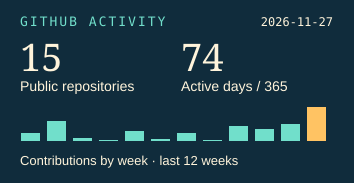
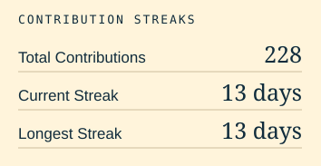

# 

When a model gives me an answer about a company, I want to see the line in its annual report that backs it up. That question got me building retrieval systems, testing LLM judges, and wiring agents together with Python and FastAPI.

I study **Computer Science & Information Technology at REVA University** (B.Tech, 2027). I’m looking for **AI and GenAI internships** and I’m also interested in **backend software engineering**. I practice data structures and algorithms in C++.

[LinkedIn](https://www.linkedin.com/in/ayush-cv-6a68a233b/) · [Selected work](#selected-work) · [Tech arsenal](#tech-arsenal) · [GitHub activity](#github-activity)

## Selected work

### [Fin Research Agent](https://github.com/Ayushcv-46/fin-research-agent)

I built a research assistant that retrieves passages from SEC 10-K filings and links its answers to the evidence. Then I tested a question I couldn’t settle by reading the answers alone.

> **Does another retrieval pass help?** Across 12 tickers, average answer relevancy was **0.743** with fixed retrieval and **0.728** with adaptive retrieval. The extra passes showed no measurable improvement in my experiment. Faithfulness was scoreable for only three tickers in each mode. [Inspect the recorded runs →](https://github.com/Ayushcv-46/fin-research-agent/blob/main/results/retrieval_comparison.json)

### [ModelMux](https://github.com/Ayushcv-46/ModelMux)

One chat API for Groq, Gemini, and local models through Ollama. I gave retries and provider fallback a shared deadline. If a circuit breaker is open, the gateway skips that provider and uses the remaining time to try a compatible one. [Read the fallback logic →](https://github.com/Ayushcv-46/ModelMux/blob/main/app/reliability/fallback.py)

### [RAG PDF Chatbot](https://github.com/Ayushcv-46/rag-pdf-chatbot)

A question can use different words from the PDF that answers it. I combine keyword and vector search, merge their rankings, then rerank the passages before the model answers across documents.

### [5-Agent Autonomous Research System](https://github.com/Ayushcv-46/5-Agent-Autonomous-Research-System)

Five agents turn a topic into a cited report. The part I like most is the handoff between critic and writer. The critic can send a draft back with specific issues, and the writer gets up to two revisions.

**More projects**

- [Intrusion Detection System](https://github.com/Ayushcv-46/intrusion-detection-system-ml) — I combined classifiers with soft voting and used SHAP to inspect their network-traffic predictions.
- [InterviewPal](https://github.com/Ayushcv-46/InterviewPal) — Mock interviews, technical trivia, and flashcards for interview practice.
- [Personal Expense Tracker](https://github.com/Ayushcv-46/Personal-Expense-tracker-) — A React and Node.js app for tracking transactions, category budgets, and monthly spending.

## Tech arsenal

**AI & retrieval** 
   

**Backend & databases** 
   

**Languages & frontend** 
   

**Testing & delivery** 
  

<strong>Inside ModelMux · stack and 60-day roadmap</strong>

- **In the gateway today** — Python, async FastAPI, Uvicorn, Pydantic, HTTPX, YAML routing, and provider adapters for Mock, Ollama, Gemini, and Groq. I use SQLAlchemy with SQLite for request and attempt records, Docker Compose for Redis, and pytest for provider contracts and outage scenarios.
- **On the roadmap** — Redis token buckets with Lua, tenant-scoped response caching with expiry, PostgreSQL, a Chart.js metrics dashboard, Locust load tests, and a GitHub Actions pipeline with Ruff, pytest, and container checks.
- **After the core build** — The roadmap leaves room for OpenTelemetry traces, server-sent event streams, shared circuit-breaker state, performance-aware routing, and experiments with semantic caching.

## GitHub activity

  
  

Both cards refresh daily from GitHub. Streaks count consecutive contribution dates since I joined. Today can still extend a streak that ran through yesterday. [View my contribution calendar →](https://github.com/Ayushcv-46#contribution-activity)

## Let’s talk

Away from code, I read philosophy, especially Advaita Vedanta. One question follows me back to my desk.

> What would change my mind about this answer?

If your team is working on retrieval, LLM evaluation, or Python backends, I’d love to hear what you’re testing. [Message me on LinkedIn →](https://www.linkedin.com/in/ayush-cv-6a68a233b/)
