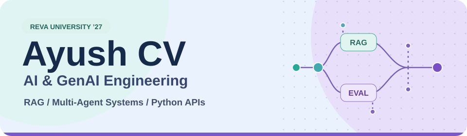
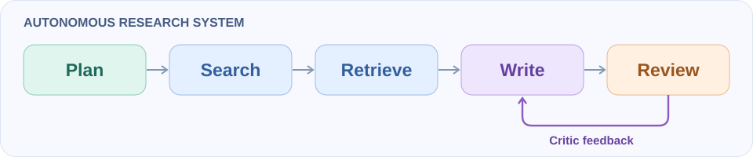
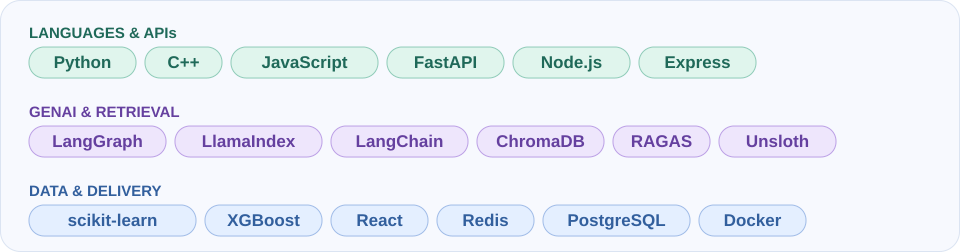
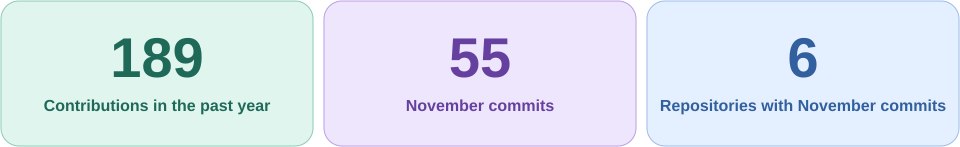

I build AI applications that retrieve evidence, cite sources, and let me test where the answers go wrong. I’m a B.Tech CS&IT student at REVA University, graduating in 2027, and open to AI/GenAI and backend engineering internships.

## Featured projects

  
  

  
  

In **Fin Research Agent**, I benchmarked adaptive retrieval against a fixed baseline. The extra retrieval passes showed no measurable gain in my experiment. **ModelMux** gives Gemini, Groq, and Ollama a common chat API with authentication, rate limiting, and fallback.

### How the research agents work

The [5-Agent Research System](https://github.com/Ayushcv-46/5-Agent-Autonomous-Research-System) uses LangGraph to run this workflow. Retrieved passages support the report, and the critic can send a draft back for revision.

### More projects

- [Intrusion Detection System](https://github.com/Ayushcv-46/intrusion-detection-system-ml) · Soft-voting ML ensemble for network traffic classification, with SHAP explanations.
- [InterviewPal](https://github.com/Ayushcv-46/InterviewPal) · AI mock interviews, technical trivia, and generated flashcards.
- [Personal Expense Tracker](https://github.com/Ayushcv-46/Personal-Expense-tracker-) · Transactions, category budgets, and spending trends.
- **Live Coding Tutor** · Team project. I contributed the AI and LLM integration.

## Tech stack

More tools and the full ModelMux stack

**ModelMux** · Python, async FastAPI, Uvicorn, Pydantic, HTTPX, Gemini, Groq, Ollama, SQLAlchemy, SQLite for local development, PostgreSQL for deployment, Redis, Docker Compose, pytest, Locust, and GitHub Actions. The roadmap also includes structured logs, metrics, and OpenTelemetry instrumentation.

**Other projects** · Tavily, Sentence Transformers, LangSmith, SHAP, pandas, NumPy, Matplotlib, Vite, Tailwind CSS, Streamlit, Recharts, Supabase, MongoDB, and Mongoose.

## GitHub activity

Snapshot from 25 November 2026 · [View current GitHub activity](https://github.com/Ayushcv-46#contribution-activity)
